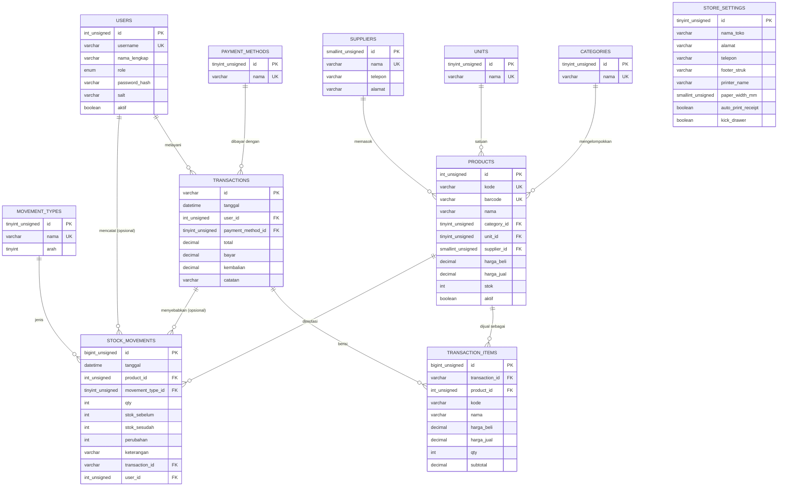
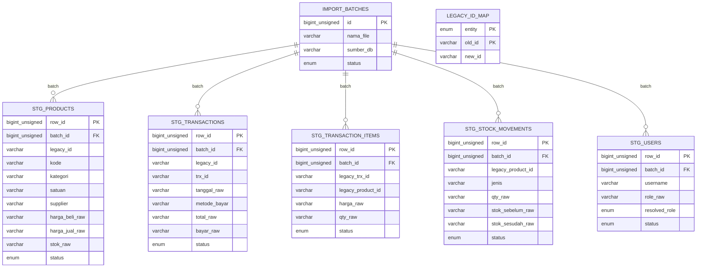

# ERD KasirKu — Skema Target

Diagram di bawah bisa dirender di GitHub, GitLab, VS Code (ekstensi Mermaid),
atau <https://mermaid.live>.

## Kardinalitas

| Relasi | Kardinalitas | Catatan |
|---|---|---|
| `categories` → `products` | 1 : N | Satu kategori dipakai banyak produk |
| `units` → `products` | 1 : N | Satuan wajib |
| `suppliers` → `products` | 1 : N | Supplier boleh `NULL` |
| `payment_methods` → `transactions` | 1 : N | Metode wajib |
| `users` → `transactions` | 1 : N | Kasir boleh `NULL` untuk data lama |
| `transactions` → `transaction_items` | 1 : N | Minimal 1 item per nota |
| `products` → `transaction_items` | 1 : N | `product_id` boleh `NULL` (snapshot tetap ada) |
| `products` → `stock_movements` | 1 : N | Kartu stok per produk |
| `movement_types` → `stock_movements` | 1 : N | Masuk (+1) / Keluar (−1) |
| `transactions` → `stock_movements` | 1 : N | Opsional, penanda mutasi dari penjualan |
| `users` → `stock_movements` | 1 : N | Opsional, pencatat mutasi |

## Tabel staging (bukan bagian aplikasi)

`legacy_id_map` tidak punya FK ke staging/target karena berfungsi sebagai
jembatan antar-schema.
